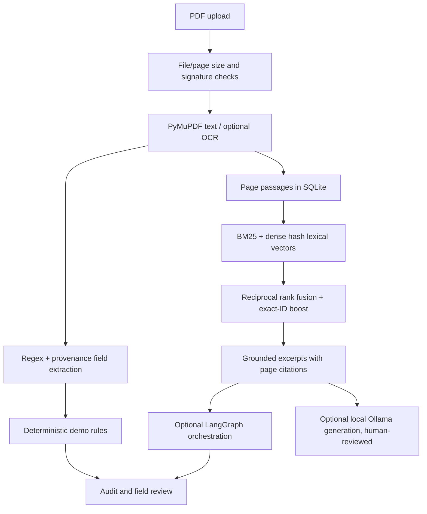

# CertFlow AI · Auditable Document Intelligence & Hybrid RAG

[](.github/workflows/ci.yml) [](pyproject.toml) [](LICENSE)

A **document intelligence service** that generates synthetic certificate-style PDFs, parses document fields with page-level provenance, flags missing/expired fields, indexes document text, and serves BM25 + dense lexical hybrid retrieval with source citations and an audit trail.
## Architecture




## Quick start (no API keys, GPU, hosted LLM, Qdrant or cloud account)

Requires Python **3.11–3.13** and [uv](https://docs.astral.sh/uv/).

```bash
uv sync --extra dev
uv run certflow generate-data
uv run certflow evaluate
uv run certflow ingest-demo
uv run pytest -q
uv run uvicorn certflow.api:app --host 127.0.0.1 --port 8001
```

Other terminal:

```bash
curl -s http://127.0.0.1:8001/health/ready
curl -s -X POST http://127.0.0.1:8001/v1/search \
  -H 'Content-Type: application/json' -d '{"query":"DEMO-CERT-1001","k":3}'
curl -s -X POST http://127.0.0.1:8001/v1/ask \
  -H 'Content-Type: application/json' -d '{"query":"DEMO-CERT-1001"}'
```

API explorer: http://127.0.0.1:8001/docs

## Capabilities

- **PDF ingestion:** inspect actual PDF bytes, reject invalid/encrypted/oversized and too-many-page PDFs; content-addressed file storage; per-workspace records and deduplication.
- **Structured extraction:** reproducible regex baseline extracts seven synthetic fields with page attribution; field completeness and date-based review flags; optional scanned-page Tesseract OCR.
- **Information retrieval:** implemented *real BM25* (`src/certflow/retrieval.py:BM25.scores`), 384-d dense **hashed lexical baseline**, reciprocal rank fusion and exact document-code boost. Optional download of `all-MiniLM-L6-v2` via Sentence Transformers for genuinely **semantic** embedding vectors.
- **Answers:** default extractive grounded snippets with page citations; optional actual `LangGraph` node graph; optional local Ollama generative experiment marked unverified and requiring human review.
- **Operations:** versioned FastAPI, upload and workspace validation, SQLite events, Prometheus metrics, containerized local deployment, integration tests and repeatable evaluation.

## Docker

```bash
docker compose up --build
```
